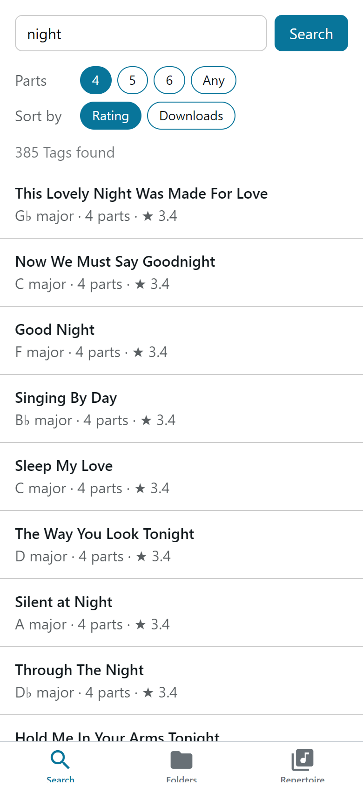
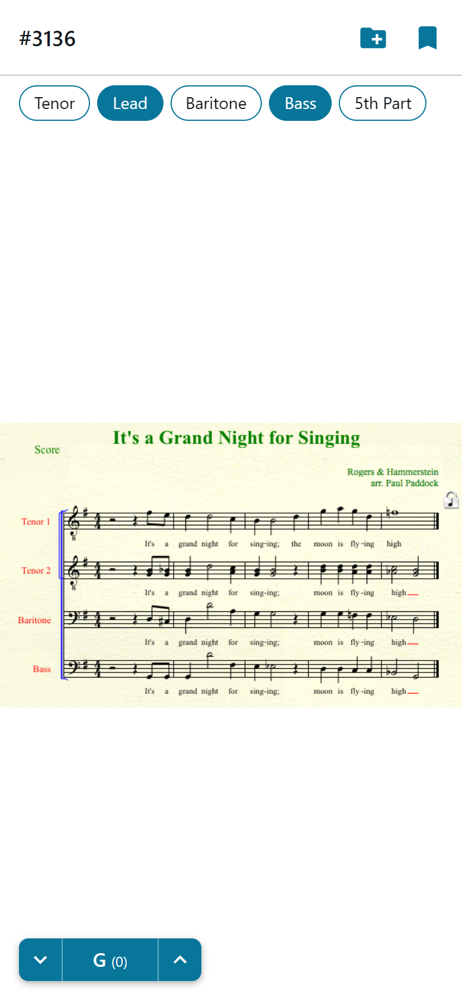
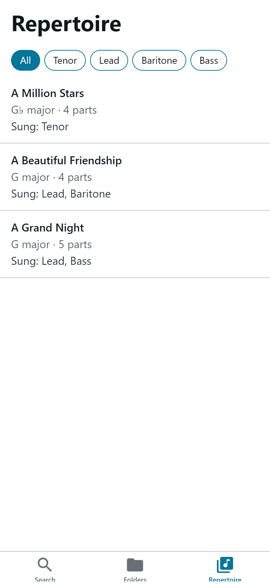

# Tagaholic

[](https://github.com/ThomasBavn/Tagaholic/actions/workflows/test.yml)

Tagaholic helps a barbershop Singer find, learn and keep track of tags from [barbershoptags.com](https://www.barbershoptags.com).

Search for a Tag, sing from its sheet music, sound the Pitch, and record which Parts you've sung. Tags you've opened stay on your phone, so you can still get to them at an afterglow with no signal. It's an Android-first [Expo](https://expo.dev) app with no account: your data stays on the device.

<p>
  
  
  
</p>

<sub>Screenshots from the web build. On a phone, the Tag page is in landscape.</sub>

## Features

- **Search** barbershoptags.com by title or lyrics, filtered by number of Parts and sorted by rating or downloads.
- **Tag page** with the sheet music in the app, PDF or image, with pinch-zoom and pan.
- **Pitch**: hold the button to sound the tonic of the Tag's Key, like a pitch pipe. Transpose it up to 11 semitones either way; it's tuned in just intonation.
- **Sung Parts**: mark which Parts you've sung on each Tag. Every Tag with a Sung Part is in your **Repertoire**, which you can filter by Part.
- **Bookmarks and Folders**: Bookmark a Tag with one tap, or file it in your own Folders.
- **Offline**: every Tag you open is saved on the device, sheet music included.

The words used here (Singer, Tag, Part, Pitch, Sung Part, Folder, Repertoire) have exact meanings, defined in [GLOSSARY.md](GLOSSARY.md).

## Status

In development, and not released yet. The [MVP spec](https://github.com/ThomasBavn/Tagaholic/issues/1) is mostly built. The [open issues](https://github.com/ThomasBavn/Tagaholic/issues) cover what's left, such as cache cleanup and dark mode.

## Run it

Requires Node 22.

```bash
npm install
npm run web       # in a browser: quickest for UI work
npm run android   # a development build on a device or emulator
```

Expo Go can't run Tagaholic, because it uses native modules for the sheet music. The Android build needs some setup (JDK 17, the Android SDK, and on Windows a short path). See [docs/development.md](docs/development.md) for that, testing on your own phone, and other development notes.

```bash
npm test          # Jest tests
npm run lint      # ESLint
```

## Project layout

```
app/          Screens, with Expo Router file-based routing
  (tabs)/     Search, Folders and Repertoire tabs
  tag/[id]    The Tag page
  folder/[id] A Folder's Tags
components/   UI components (sheet music viewers, Pitch button, Part chips, …)
core/         Domain logic with no UI: search, Tag XML parsing, Sung Parts,
              Folders, the offline cache, Pitch maths
  fixtures/   Recorded barbershoptags.com responses used by the tests
scripts/      Pitch sample generator
android/      Checked-in native Android project
docs/         Development notes and architecture decision records
```

`core/` reaches the outside world only through the ports in [core/ports.ts](core/ports.ts) (Tag source, storage, files, clock), so its tests run against recorded fixtures instead of the network.

## Docs

- [GLOSSARY.md](GLOSSARY.md): the domain language.
- [docs/development.md](docs/development.md): building, running and testing.
- [docs/adr/](docs/adr/): why things are the way they are, such as [calling the barbershoptags.com API directly](docs/adr/0001-call-barbershoptags-api-directly.md) and [the sheet music viewers](docs/adr/0002-sheet-music-viewers.md).